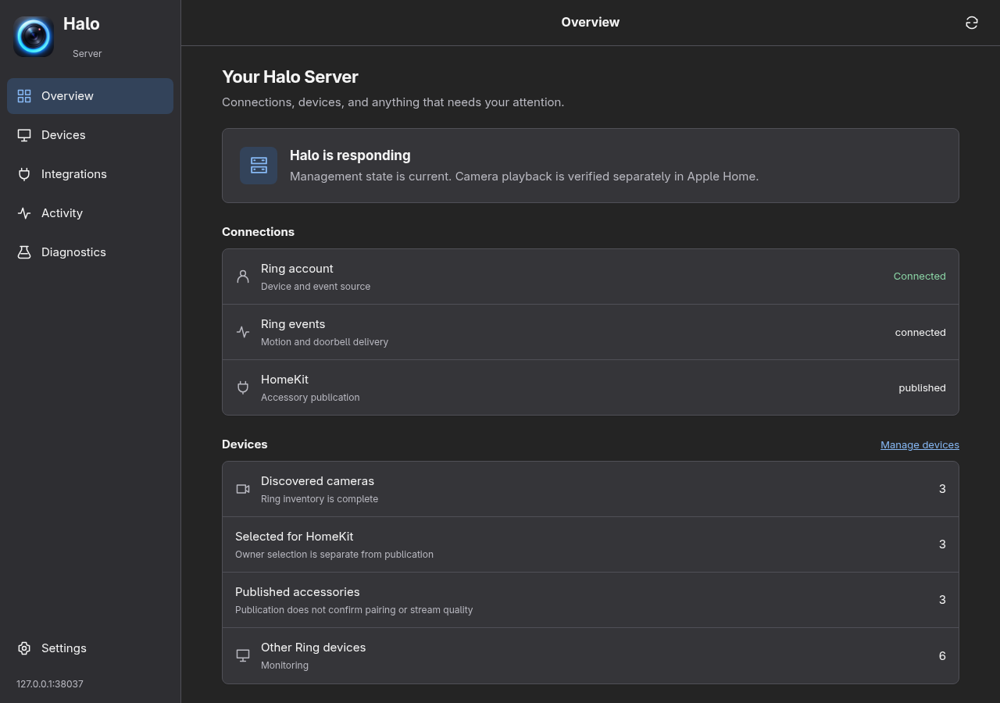
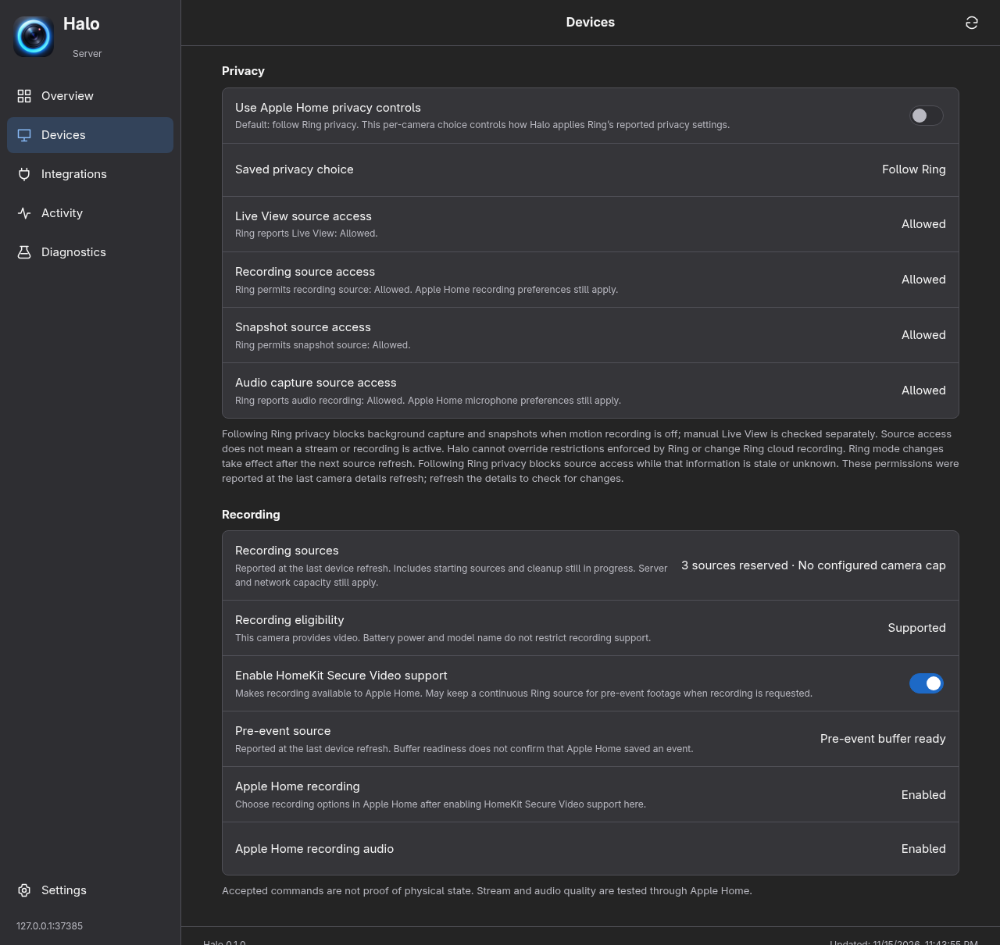
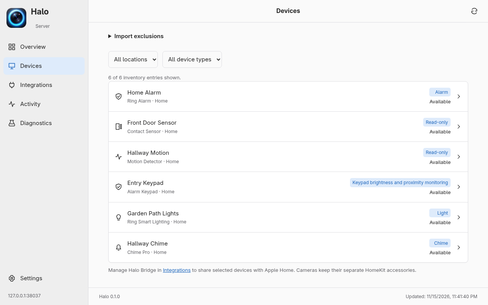

  

<h1 align="center">Halo Server</h1>

  <strong>Your Ring home. Connected to Apple Home.</strong> 
  Bring cameras, sensors, lights, and your Ring Alarm together through a server you control. 
  Watch in Apple Home. Manage your setup from a familiar, beautifully simple web interface.

  <a href="#meet-halo-server">Product Tour</a> &middot;
  <a href="#made-for-your-home">Features</a> &middot;
  <a href="docs/server-guide.md#installation">Install</a> &middot;
  <a href="docs/server-guide.md">Server Guide</a>

  
  
  
  

Actual Halo Server interface with demonstration devices and account data. No private camera feeds or Ring account were used for these screenshots.

## Meet Halo Server

Your cameras belong alongside the rest of your home. Halo Server connects Ring
to Apple Home directly, while a dedicated server keeps devices, events, and
connections running in the background. Open the web console when you need it;
close it when you are done.

The interface shares Halo GTK's visual language: clean navigation, familiar
controls, light and dark appearances, and layouts that fit a desktop or phone.

### Cameras that feel at home

See who's at the door, check the garden, or answer from another room. Halo brings
live video, camera audio, two-way talk, snapshots, motion, and doorbell events
into Apple Home. Each camera pairs as its own accessory, ready to place in the
right room and use with your Home automations.

Enable **HomeKit Secure Video** support for the cameras you choose, then set
streaming, recording, and recording-audio preferences in Apple Home. Halo's web
console keeps each camera's connection, privacy, and recording choices together.

### One bridge. More of your home.

Pair **Halo Bridge** once to bring selected Ring devices into Apple Home alongside
your cameras. Choose what belongs in your home, keep related devices organized,
and grant control separately from monitoring.

- **Ring Alarm:** view security state and use normal Home, Away, and Disarm controls.
- **Sensors:** bring supported contact, motion, leak, smoke, and carbon monoxide
  observations into Home.
- **Lighting:** control supported Ring Smart Lighting and lighting groups, plus
  the lights on compatible cameras.
- **Keypads:** manage supported keypad brightness, lock the chosen level, and use
  reported proximity motion.
- **Chimes:** manage supported Chime volume, snooze, and nightlight settings from
  the web console, with deliberate sound tests when you need them.

Available services and controls depend on the device and Ring account. The
[device guide](docs/server-guide.md#devices-and-controls) covers those details.

### Privacy with a clear choice

Halo respects Ring's camera privacy settings by default. For a home managed
through Apple Home, choose **HomeKit-managed privacy** per camera and configure
when it may stream or record there. Camera access and microphone permissions
remain explicit, and opening the web console never starts a camera stream.

## Made for your home

| Feature | What it brings to your day |
| --- | --- |
| **Direct Apple Home integration** | Standalone cameras and a shared device bridge, managed from one place. |
| **Live video and two-way audio** | Watch, listen, and talk through compatible Ring cameras in Apple Home. |
| **HomeKit Secure Video** | Per-camera recording support with recording choices controlled in Apple Home. |
| **Motion and doorbell events** | Ring events carried into Home for notifications and automations. |
| **A familiar web console** | Manage devices, pairing, privacy, activity, and settings from a desktop or phone. |
| **Protected administration** | HTTPS, an owner sign-in, and password confirmation for sensitive actions. |
| **Deliberate device controls** | Separate control permissions, confirmation for sensitive actions, and visible reported state. |
| **Useful diagnostics** | Connection health, recent activity, local checks, and sanitized support reports. |
| **Independent operation** | A background service with browser, terminal, and command-line administration. |

## Make room for Halo

Start with a Linux server, your Ring account, and Apple Home. The
**[Server Guide](docs/server-guide.md)** walks through supported platforms,
installation, secure browser access, pairing, and everyday operation.

- [Choose a platform and check requirements](docs/server-guide.md#platforms-and-requirements)
- [Install Halo Server](docs/server-guide.md#installation)
- [Set up the web console](docs/server-guide.md#web-console)
- [Connect cameras and Halo Bridge to Apple Home](docs/server-guide.md#connect-to-apple-home)
- [Configure recording and privacy](docs/server-guide.md#recording-and-privacy)
- [Updates, recovery, and troubleshooting](docs/server-guide.md#operations-and-troubleshooting)

Halo uses Ring's online services. HomeKit Secure Video requires an eligible Apple
Home setup and [iCloud+ plan](https://support.apple.com/en-gb/guide/icloud/mme054c72692/icloud); Ring features remain subject to device capabilities
and account permissions. See the guide for requirements and compatibility details.

## Part of Halo

Prefer a native desktop companion? **[Halo GTK](https://github.com/JamesFromFL/halo-gtk)**
brings Ring live monitoring, event history, and media tools to Linux with GTK 4
and libadwaita. Halo Server carries the same visual identity into your home server.

Halo Server is free and open source under the [GPL-3.0-or-later license](LICENSE).
It is an independent project and is not affiliated with or endorsed by Ring,
Amazon, or Apple.
