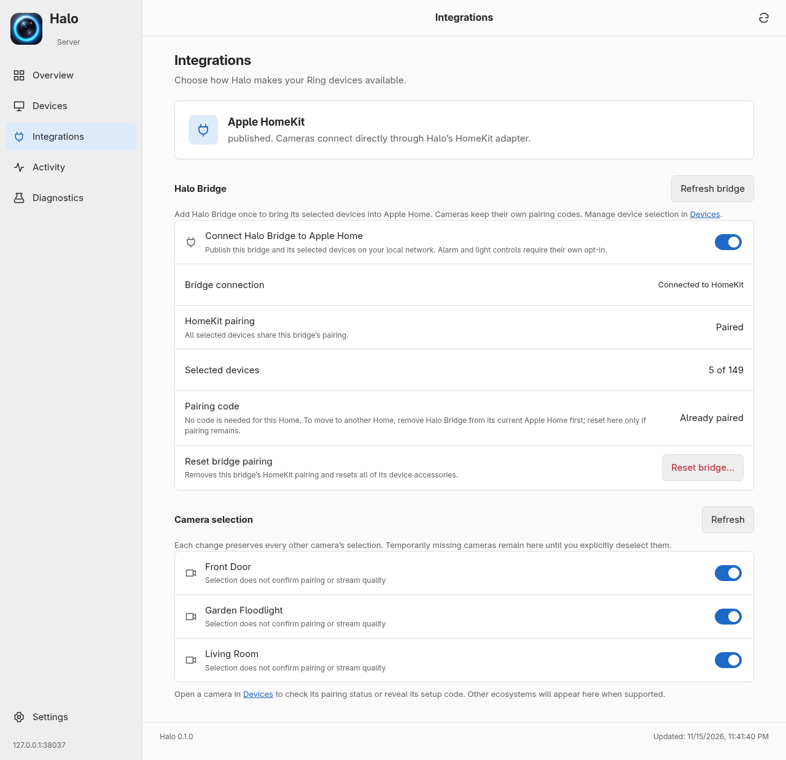

# Halo Server guide

Installation, platform support, account setup and day-to-day operation. See the
[README](../README.md) for the product overview and screenshots.

- [Platforms and requirements](#platforms-and-requirements)
- [Installation](#installation)
- [Web console](#web-console)
- [Connect to Apple Home](#connect-to-apple-home)
- [Recording and privacy](#recording-and-privacy)
- [Devices and controls](#devices-and-controls)
- [Network and private data](#network-and-private-data)
- [Operations and troubleshooting](#operations-and-troubleshooting)
- [Development and documentation](#development-and-documentation)

## Platforms and requirements

Halo runs on an always-on computer with internet access to Ring and local-network
access to Apple Home. The daemon owns the Ring session; closing its web console
or terminal interface leaves it running. Direct HomeKit and the managed HTTPS
companion currently target **Linux**.

These tiers describe repository qualification scope, not a promise that every
model, host configuration or distribution release has been tested.

| Platform | Qualification | Notes |
| --- | --- | --- |
| Arch Linux, x86_64 | Development and local package verification | Principal development environment; managed archives must match the receiving host. |
| Ubuntu 24.04, x86_64 | Primary CI target | Native integration, package and browser checks use an explicit Ubuntu 24.04 runner. Portable Python contracts also run on `ubuntu-latest`; this does not establish native results for every Ubuntu version. |
| Debian 12 or newer, x86_64 | Source target | Documented dependencies; distribution-specific clean-host/media qualification remains separate. |
| Fedora 42 or newer, x86_64 | Source target | Documented dependencies; distribution-specific clean-host/media qualification remains separate. |
| Linux ARM64 | Unqualified | x86_64 packages/results do not establish ARM64 support. |
| macOS, Apple Silicon or Intel | Experimental source use | Direct HomeKit and managed HTTPS/services are not qualified. Compatibility experiments need matching Homebrew Python/GStreamer bindings. |
| Windows with WSL2 | Experimental Linux use | Discovery, routing and unattended operation need separate qualification. |
| Native Windows | Unsupported | Halo relies on Unix peer credentials, POSIX permissions, file locks and local sockets. |

| Dependency | Requirement |
| --- | --- |
| Python | 3.11 through 3.14 (`>=3.11,<3.15`) |
| Python tooling | `uv 0.11.24` and the checked-in lockfile |
| HomeKit adapter | Node **26.12.1**, npm **12.2.1** for its build, and compiled adapter resources |
| Native media | Locked PyAV/aiortc/SRTP dependencies; H.264, AAC, Opus and JPEG codecs |
| Web frontend | Packaged static assets; Node rebuilds them but does not serve the website |
| Optional RTSP compatibility | System PyGObject, GStreamer and RTSP/RTP/parser plugins |
| Managed services | Linux systemd user service manager |

Native HomeKit uses **FFmpeg libraries through PyAV**, with reference libopus
decoding where needed. No custom FFmpeg command-line arguments are required.
CI installs the `ffmpeg` executable for validation; that alone does not supply
a missing PyAV codec or HomeKit adapter. `halo-server doctor --probe` checks local
codecs/resources without logging into Ring or opening cameras.

HomeKit Secure Video requires eligible iCloud+ access and a compatible home hub.
Consult [Apple's setup guidance](https://support.apple.com/guide/icloud/mm7c90d21583/icloud)
for current device/account requirements. Ring permissions, connectivity and
applicable subscription requirements still apply; Halo does not bypass them.

## Installation

Choose a source checkout or a trusted managed archive qualified for your exact
host. Run as the user who will own credentials and pairings, rather than root.
Do not run a foreground daemon and managed service against the same state.

### From source

Get the repository and pinned [uv release](https://docs.astral.sh/uv/getting-started/installation/):

```sh
git clone https://github.com/JamesFromFL/halo-server.git
cd halo-server
curl -LsSf https://astral.sh/uv/0.11.24/install.sh | sh
export PATH="$HOME/.local/bin:$PATH"
uv --version
```

Install Node **26.12.1** from the [official distribution](https://nodejs.org/en/download),
then select the pinned npm:

```sh
npm install --global --ignore-scripts --no-audit --no-fund npm@12.2.1
node --version
npm --version
```

Expected output: `v26.12.1` and `12.2.1`. Keep that Node executable on the service's
`PATH`. Use your distribution's Python 3.11–3.14 for the environment:

```sh
uv venv --python /usr/bin/python3 --system-site-packages
uv sync --frozen --all-groups
cd homekit-adapter
npm ci --ignore-scripts --no-audit --no-fund
npm run check
npm run build
cd ../web-ui
npm ci --ignore-scripts --no-audit --no-fund
npm run build
cd ..
uv run --frozen halo-server doctor --probe
uv run --frozen halo-server daemon --mode homekit
```

The build supplies `homekit-adapter/dist/src/main.js` and its device companion.
Keep the checkout and dependencies available; startup does not download or build
them. A standalone Python wheel is not a complete direct HomeKit installation.
Before first startup/publication, Doctor can report state or pairing directories
as `unverified/not-created`. Halo creates them when needed; do not reset pairing
or create pairing records by hand. Missing codec or adapter errors still need
attention before using HomeKit.

Leave the daemon running. In another terminal in the checkout:

```sh
uv run --frozen halo-server config set --mode homekit
uv run --frozen halo-server tui
```

This saves HomeKit mode for future starts. A missing configuration otherwise
defaults to compatibility mode. The explicit first-launch flag avoids starting
optional RTSP. In subsequent examples, source users substitute
`uv run --frozen halo-server` for `halo-server`; managed users use their
`PREFIX/bin/halo-server` launcher.

### Optional system media packages

Compatibility RTSP and the full source test suite additionally need these packages.
Use the distribution's Python so it shares an ABI with PyGObject.

```sh
# Arch Linux
sudo pacman -S --needed python-gobject gst-rtsp-server \
  gst-plugins-base gst-plugins-good gst-plugins-bad ffmpeg

# Debian / Ubuntu
sudo apt install python3-gi gir1.2-gst-rtsp-server-1.0 \
  gstreamer1.0-plugins-base gstreamer1.0-plugins-good \
  gstreamer1.0-plugins-bad ffmpeg

# Fedora
sudo dnf install python3-gobject gstreamer1-rtsp-server \
  gstreamer1-plugins-base gstreamer1-plugins-good gstreamer1-plugins-bad-free
```

RTSP checks for `appsrc`, `queue`, `h264parse`, `rtph264pay` and `rtpopuspay` at
startup. Ubuntu 22.04's default Python 3.10 is below Halo's minimum. Experimental
macOS compatibility work uses Homebrew `gstreamer` and matching Python with
`--system-site-packages`; check Python's version and imports of both `Gst` and
`GstRtspServer`. This does not qualify native HomeKit or managed macOS services.

### Managed offline release

A managed archive includes Python dependencies, production adapter, web assets
and official Node runtime. It supports `homekit` and `ring-only`, without bundled
GStreamer RTSP. It is **not a portable Linux binary**: interpreter, ABI and library
hashes must match the qualified host. An OS update may require a rebuilt archive.

Obtain the archive and receipt through a trusted channel. Verify its SHA-256
before executing the installer. A checksum from the same untrusted download
establishes integrity, not publisher authenticity.

Use the exact interpreter and values from the receipt in this template:

```sh
install -d -m 700 /absolute/halo-prefix /absolute/halo-prefix/releases
tar -xJf RELEASE_ID.tar.xz --no-same-owner --same-permissions \
  -C /absolute/halo-prefix/releases
/absolute/path/to/qualified-python -I -S -B \
  /absolute/halo-prefix/releases/RELEASE_ID/install.py \
  --manifest-sha256 MANIFEST_SHA256 \
  --state-directory /absolute/canonical/halo-state \
  --prefix /absolute/halo-prefix \
  activate --release-id RELEASE_ID --expected-revision 0 \
  --install-unit --install-web-unit --initial-mode homekit
```

Installation prepares/starts the daemon, without replacing unrelated units or
enabling login startup. It prepares the independent web unit; configure access
before starting it. Preserve the canonical state directory across updates.

```sh
systemctl --user enable halo-server.service
```

This enables user-session startup. For unattended operation before login, arrange
user lingering explicitly with the administrator and verify a reboot. Read the
[managed release](managed-releases.md) and [activation](managed-release-activation.md)
guides for complete trust, installation and rollback procedures.

## Web console

The single owner account is **`admin`**. There is no default password, and the
Halo password is separate from your Ring password.

```sh
halo-server web configure
halo-server web setup
```

`configure` prints the URL/certificate fingerprint. `setup` prints a single-use
code valid for ten minutes. Source users then run `halo-server web` in another
terminal. For the installed managed companion:

```sh
systemctl --user enable --now halo-server-web.service
```

Open **`https://127.0.0.1:18444`** on the server, verify its certificate against the
trusted terminal's fingerprint, enter the code and choose a **15–128 character**
password privately. Keep credentials/setup codes out of screenshots and reports.

For access from another LAN device, configure the actual server address before
starting the companion; the address below is only an example:

```sh
halo-server web configure --host 192.168.1.20 \
  --canonical-host 192.168.1.20 --allow-lan
```

Changing an existing certificate's hostname requires `--renew-certificate` and
renewed browser trust. Alternatively import a matching trusted certificate/key
locally with `web certificate`. Port **18444** is configurable with
`web configure --port`; inspect settings with `web access`. Keep the owner console
off the public internet. Certificate trust does not pair a HomeKit camera.

The console offers Overview, Devices, Integrations, Activity, Diagnostics and
Settings, with light/dark/system appearance. Browsing it does not open cameras
or request snapshots. The [web guide](web-interface.md) covers TLS and sessions.

## Connect to Apple Home

In **Settings → Ring account**, choose **Connect Ring** and complete Ring login
and verification privately. `halo-server tui` also supports two-factor login.
Keep an existing connected account during upgrades. Halo owns one active Ring
session; identities/preferences/control grants are scoped to that account.

### Cameras

1. Use HomeKit mode and confirm Doctor/adapter readiness.
2. Select cameras in **Devices** and wait for publication/pairing status.
3. Reveal each camera's setup code after confirming the Halo password.
4. Add it in Apple Home and choose its room/settings.

**Cameras pair individually.** Already-paired cameras need no new code. Do not
reset one merely to reveal a code. CLI equivalents:

```sh
halo-server homekit list
halo-server homekit select CAMERA_ID ANOTHER_CAMERA_ID
halo-server homekit pairing list
halo-server homekit pairing reveal CAMERA_ID
```

`select` replaces the entire set, so include existing selections when adding a
camera. Web/TUI selection buttons preserve other selected cameras.

### Halo Bridge

Enable non-camera monitoring in **Devices**, review the import preview and select
supported devices. In **Integrations**, choose **Connect Halo Bridge to Apple Home**,
reveal its code and pair once. Cameras stay standalone.

Discovery, import, publication and control permission are separate choices.
Importing an alarm/light does not enable controls. Groups require explicit
inclusion even with auto-import, avoiding unexpected duplicate lighting controls.



*The interface above uses demonstration devices and pairing status.*

## Recording and privacy

In **Devices → camera → Recording**, enable **HomeKit Secure Video support**, then
choose recording/audio/Home-Away behavior in Apple Home. Halo's switch prepares
the source; it does not grant Apple's recording permission or create a clip.

```sh
halo-server homekit warm CAMERA_ID on
halo-server homekit warm CAMERA_ID off
```

Every selected video-capable camera is eligible, including battery cameras and
unknown power classifications. Halo has no separate two-camera recording cap;
CPU, network, Ring delivery, bounded workers and Apple account limits still
constrain practical capacity. Pre-event capture can keep a stream open, illuminate
the camera's access indicator and consume battery. A cold/reconnecting source
cannot supply footage it never retained. Verify clips/audio in Apple Home.

Halo follows Ring privacy by default, checking Live View, background capture and
microphone permissions separately. Missing/stale permissions block affected access.
**HomeKit-managed privacy** is an explicit, password-confirmed per-camera choice:
allow Live View/motion detection in the Ring modes you need, then configure privacy
in Apple Home. Halo still enforces Apple's camera/audio/snapshot/recording settings.
This does not alter Ring settings/cloud recordings, enable HKSV itself or bypass
Ring-enforced restrictions. Other integrations still honor Ring privacy.

Privacy changes retire old media authority and cached/history data. Ring changes
normally arrive on the next inventory refresh. See the [privacy details](engineering/camera-privacy-2026-11-15.md).

HomeKit negotiates quality: the classic live catalogue advertises H.264 up to
**1920×1080**, not every Ring source's full resolution. Compatible compressed
media is preserved; format/bitrate/timing mismatches can require conversion.
Live audio is mono Opus; HKSV uses H.264/AAC fragmented MP4.

Halo is not a continuous local DVR. Live/event leases have a ten-minute absolute
lifetime, intercom five minutes and snapshot leases thirty seconds. Recording
has separate job/history ownership. Expired live consumers reconnect; opted-in
pre-event capture is a distinct choice. RTSP lease URLs are not permanent mounts.

## Devices and controls

Support depends on model, fresh evidence and Ring role. Unknown/stale values stay
unknown rather than becoming fabricated closed, dry, disarmed or off states.

| Family | Halo behavior | Apple Home |
| --- | --- | --- |
| Cameras/doorbells | Video/audio, snapshots, events, talkback, recording/privacy and supported light/siren controls | Standalone camera/doorbell |
| Contact sensors/retrofit zones | Contact/health observations | Contact sensor |
| Motion sensors | Motion/health observations | Motion sensor |
| Flood/flood-freeze sensors | Leak and other reported observations | Leak; no invented temperature/freeze service |
| Smoke/CO alarms/listeners | Smoke/CO observations | Applicable smoke/CO services |
| Alarm panel | Modes, entry/exit/alarm phases, faults, guarded normal controls | Security system |
| Supported physical Smart Lighting/Beams | State and finite manual On | Light |
| Lighting groups | Aggregate state and permitted group commands | Explicitly selected group light |
| Qualified keypad | Brightness, persistent lock, evidence-qualified proximity | Dimmable light, lock switch, conditional motion |
| Qualified legacy Chime | Volume, snooze, available automatic nightlight and permitted sound tests | Halo controls; no fabricated HomeKit Chime service |

Non-camera services use Halo Bridge. Unknown hardware can remain visible without
invented controls. Generic switches/outlets, locks, valves, thermostats, newer
Chimes and access-control products require model-specific support.

Normal alarm controls require opt-in, owner-role evidence and fresh panel state.
They permit Home/Away/Disarmed; unknown/shared roles stay read-only. Night is not
silently mapped to another mode. Panic, dispatch, bypass and active-alarm
cancellation are blocked; use Ring's app/keypad for those workflows. Triggered
state reaches HomeKit, while notifications/interruption behavior depend on Apple
Home/device permissions. Halo is not a monitored alarm or guaranteed alert service.

Camera lights use native On/Off. Halo reports fresh light state and motion shutoff
interval when supplied; motion configuration stays in Ring. Halo adds no indefinite
hold or repeated On keepalive. Verify whether a particular camera's manual On
survives its motion timeout before relying on physical-switch automation.

Standalone Smart Lighting offers finite On durations (30 seconds, 1, 5 or 15
minutes). **Return to automatic** releases the override; Ring motion/schedules
may still keep it on. Group Off leaves future automation available, and aggregate
state does not prove all members match.

Keypad **Brightness lock** starts locked when enabled, survives restart and blocks
Halo/HomeKit light writes. It cannot block Ring firmware/app changes. Brightness
means configured level, not currently illuminated LEDs. Motion requires a qualified
proximity event. Camera siren On remains bounded to 30 seconds; Chime sound tests
require separate permission/confirmation. Uncertain commands are not automatically
replayed, and acknowledgement alone is not physical confirmation.

## Network and private data

| Service | Default/allocation | Scope |
| --- | --- | --- |
| Owner web | HTTPS TCP **18444**, initially `127.0.0.1` | LAN binding explicit |
| Owner administration | Unix socket `admin.sock` | Same local user |
| HomeKit discovery | mDNS/Bonjour | Reachable controller/home hub LAN |
| HomeKit accessory/HDS | Dynamic TCP ports | No fixed `51826` setting |
| HomeKit media | Negotiated UDP/SRTP | Reachable controller/home hub path |
| Compatibility API | `127.0.0.1:18443` HTTP/WebSocket | Authenticated loopback |
| Compatibility RTSP | `127.0.0.1:18554` | Digest-authenticated loopback |

Web port changes do not change HomeKit ports. Guest isolation/VLAN/VPN routing can
affect discovery/playback. Compatibility consumers such as Scrypted must share
Halo's network namespace; these plugin/RTSP listeners do not offer TLS-protected
remote access and should not be publicly forwarded.

Modes are `homekit` (native Apple Home), `ring-only` (administration/Ring session),
`compatibility` (plugin/RTSP), or `dual` (both paths). The latter two require source
GStreamer dependencies. `config get` separates saved/applied settings; `config set`
does not restart automatically. A daemon `--mode` flag affects only that run.

State defaults to `${XDG_STATE_HOME:-$HOME/.local/state}/halo-server`, containing
credentials, identities, pairings/preferences and web authentication/TLS. Keep it
private and owned by the service user; do not copy pairings to another running
instance. Runtime sockets use `$XDG_RUNTIME_DIR/halo-server`, then
`/run/user/$UID/halo-server` if available, otherwise private
`/tmp/halo-server-runtime-$UID`. Place path overrides after the top-level command:

```sh
halo-server homekit --state-directory /private/state --runtime-directory /private/run list
halo-server web --state-directory /private/state --runtime-directory /private/run access
```

Managed launchers bind canonical state. Code rollback does not restore old data.
Backups contain secrets; restoring old pairing/pending-operation state is not an
ordinary upgrade recovery step.

## Operations and troubleshooting

For managed updates, verify/stage the matching archive, close terminal clients,
and let controls settle. Use the current selection revision:

```sh
/absolute/halo-prefix/bin/halo-release \
  --state-directory /absolute/canonical/halo-state \
  activate --release-id NEW_RELEASE_ID --manifest-sha256 NEW_MANIFEST_SHA256 \
  --expected-revision CURRENT_REVISION
```

Activation retires daemon/web owners before switching code and preserves enabled/
active states separately. Inspect/wait on busy work; never delete locks or edit
immutable releases. `halo-release rollback --expected-revision CURRENT_REVISION`
selects compatible previous code with current data; minimum reader versions still
apply. Follow the [activation guide](managed-release-activation.md).

For source updates, stop daemon/companion, update source, repeat locked dependency
sync and both builds, check diagnostics and restart with the same owner/state.
Do not mix source and managed launch methods.

Lost web password: `halo-server web reset --yes` issues a new setup code and revokes
web authentication while preserving Ring, pairings and preferences. Choose a new
password privately and use `admin`. Pairing reset is a separate action.

```sh
halo-server status
halo-server config get
halo-server doctor
halo-server doctor --probe
halo-server support --output ./halo-support.json
```

Support creates a new private file excluding credentials, codes, footage, signed
URLs, account email and private home paths. Review other attachments separately.

| Symptom | Check first |
| --- | --- |
| Web unavailable | Companion health, `web access`, port/address/certificate |
| Blank/stale page after update | Reload, selected release and companion health; current HTML is uncached |
| Ring disconnected | Settings/event health; reauthenticate only if required |
| Selected camera absent | Mode, codec/adapter readiness, publication; selection is not pairing |
| Code reveal unavailable | Already-paired cameras need no new code; unknown status needs refresh/healthy adapter |
| Preview/live failure | Source, privacy, push health and HomeKit network path |
| No HKSV clips | Halo opt-in, Apple settings/account/hub, retained history and events |
| Out-of-date sensor | Monitoring, hub/location connectivity and freshness |
| Control unavailable | Opt-in, owner role, fresh state and keypad lock |
| Uncertain command | Inspect current state/existing operation instead of repeating it |
| Managed failure after OS update | Requalify host/interpreter/libraries; do not disable integrity checks |
| Pairing recovery marker | Preserve files/marker for explicit recovery rather than deleting them |

Activity is bounded recent activity, not a permanent audit. [Stream diagnostics](engineering/bounded-stream-diagnostics.md)
can capture private excerpts/timing for coordinated investigation; those are
separate from sanitized support exports and need deliberate owner handling.

## Development and documentation

```sh
uv lock --check
uv run --frozen pytest
uv run --frozen ruff check --no-cache src tests
uv run --frozen ruff format --check --no-cache src tests
uv build --out-dir dist
```

Run `npm run check`, `npm run build`, `npm test` in `homekit-adapter`, and
`npm run verify` in `web-ui`. Full Python tests need system media/built adapter;
browser tests need pinned Playwright browsers. [CI](../.github/workflows/ci.yml)
also performs advisory and installed-wheel checks. Fixtures/probes do not prove
every physical model, controller, recording load or notification delivery.

| Document | Details |
| --- | --- |
| [Owner administration](owner-administration.md) | CLI/TUI, selection, pairing and diagnostics |
| [Web interface](web-interface.md) | TLS, enrollment, sessions and UI behavior |
| [Managed releases](managed-releases.md) | Trust, qualification and offline assembly |
| [Release activation](managed-release-activation.md) | Services, upgrades, rollback/removal |
| [HomeKit acceptance](homekit-acceptance.md) | Physical verification checklist |
| [Non-camera acceptance](noncamera-acceptance.md) | Device-family/control verification |
| [Engineering notes](engineering/README.md) | Dated research, decisions and test evidence |
| [Adapter internals](../homekit-adapter/README.md) | HAP dependency, protocol and media contracts |

Historical notes/runbooks retain candidate-specific versions and pending
checklists; they are not the current installed-version report. Check your launcher,
status and release receipt. Halo is an independent GPL-3.0-or-later project.
Ring/Apple services and policies can change independently. Use [GitHub Issues](https://github.com/JamesFromFL/halo-server/issues)
with version/release, platform, model, expected behavior and a sanitized report.
